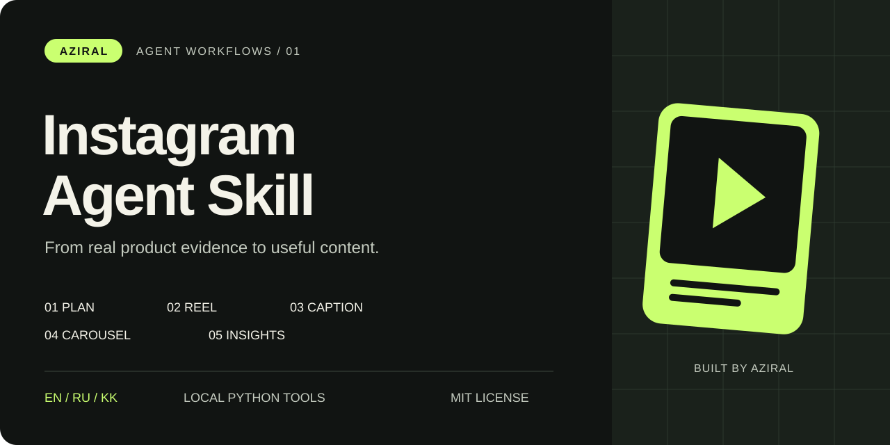

# Instagram Agent Skill от AZIRAL



**Пять навыков для контента основателя и продукта на русском, английском и казахском.**

Контент-план, сценарии Reels, подписи, карусели и анализ вашей статистики. Инструменты Python работают локально. Факты и смысл сохраняются между языками, публикация остаётся в рамках ваших указаний.

[English](README.md) · [Қазақша](README.kk.md) · [MIT](LICENSE)

## Установка

```sh
npx skills add azirali/instagram-agent-skill
```

Выберите своего агента и область установки. Можно установить отдельный навык:

```sh
npx skills add azirali/instagram-agent-skill --skill aziral-instagram-caption
```

| Навык | Результат |
| --- | --- |
| `aziral-instagram-plan` | Позиционирование, факты и реалистичный контент-план |
| `aziral-instagram-reel` | Реплики, раскадровка и оценка времени речи |
| `aziral-instagram-caption` | Тексты RU/EN/KK, alt text и проверка текста |
| `aziral-instagram-carousel` | Карусель или серия Stories с визуальными указаниями |
| `aziral-instagram-insights` | Сравнение показателей CSV внутри каждого формата |

## Пример запроса

```text
Используй $aziral-instagram-reel. По этой записи прототипа приложения
подготовь Reel на 30 секунд: одна функция и её видимый результат.
Нужны отдельные RU, EN и KK версии. Не добавляй выдуманные результаты,
клиентов или выручку. Сначала дай раскадровку и оценку времени речи.
```

Навыки готовят материалы. В наборе нет интеграции автопубликации. Для подготовки не нужны пароль Instagram, Meta API или платный сервис; использование вашего AI-агента может иметь свою стоимость. Для рендера видео отдельно задайте инструмент и предоставьте материалы.

## Локальные инструменты

Python 3.10+, без сторонних пакетов. Из корня репозитория:

```sh
python3 skills/aziral-instagram-caption/scripts/caption_check.py examples/caption.ru.txt --language ru --strict
python3 skills/aziral-instagram-reel/scripts/beat_sheet.py examples/reel.kk.txt --wpm 145 --target 30
python3 skills/aziral-instagram-insights/scripts/insights.py examples/insights.csv
python3 -m unittest discover -s tests -v
```

Результат инструментов - JSON. Исходные файлы не меняются, запросов в сеть нет. Проверка подписи сохраняет emoji и казахские буквы, отмечает незаполненные факты и превышение заданных редакционных ограничений. Предпросмотр текста не повторяет точную вёрстку Instagram. Время речи приблизительное: финальный текст нужно прочитать и засечь.

В аналитике пропуск отличается от нуля. При нулевом или неизвестном охвате коэффициент остаётся `null`. Просмотры сравниваются с медианой переданной выборки того же формата, включая сам пост. Это описание данных, без прогноза вирусности или доказательства причин роста.

Данные [примера CSV](examples/insights.csv) синтетические. Это не показатели аккаунта AZIRAL. [Примеры текстов](examples) показывают возможности набора; готовые изображения и видео в него не входят.

## Авторство и лицензия

Самостоятельная работа **Олжаса Азирали / AZIRAL**, [MIT](LICENSE). Источник вдохновения - [проект Jake Schincariol](https://github.com/Jakeschincariol/instagram-agent-skill). Его файлы, формулы, оценки и исследования не включены. Подробности в [NOTICE.md](NOTICE.md). Связи или одобрения со стороны исходного автора, Instagram или Meta нет.

[AZIRAL](https://aziral.com) · [Олжас Азирали](https://aziral.com/olzhas-azirali) · [Все навыки и инструкции](README.md)

Если набор пригодился, звезда помогает другим его найти.
